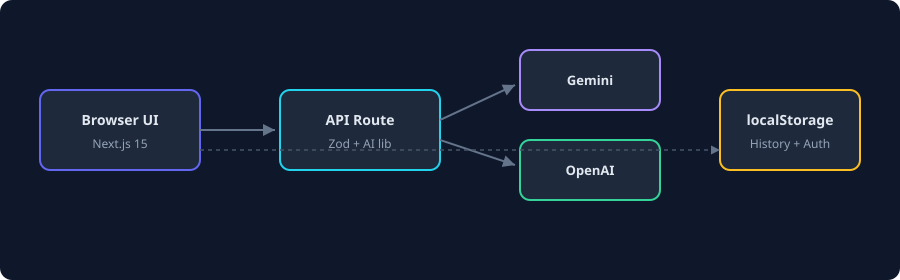

<div align="center">


# ⚡ NoteForge

### AI-powered study companion that turns raw notes into mastery

[](https://nextjs.org/)
[](https://www.typescriptlang.org/)
[](https://tailwindcss.com/)
[](LICENSE)
[](CONTRIBUTING.md)

**International hackathon project** · Built for students worldwide 🌍

[Features](#-features) · [Quick Start](#-quick-start) · [Architecture](#-architecture) · [Demo](#-demo-mode) · [Contributing](#-contributing)

</div>

---

## 🎯 What is NoteForge?

NoteForge transforms **raw study notes** (paste or upload PDF / Markdown) into:

| Mode | Output | Best for |
|------|--------|----------|
| 🧠 **Quiz** | Interactive MCQ + fill + short answers with scoring | Active recall |
| 📚 **Concepts** | Structured breakdowns + analogies | Understanding |
| 🃏 **Revision** | Cheat sheet + flip flashcards + high-yield list | Exam crunch |



---

## ✨ Features

| Feature | Status | Notes |
|---------|--------|-------|
| Interactive quiz + live score | ✅ | Retry, progress bar, PDF export |
| Concept breakdown | ✅ | Key points + analogies |
| Flip flashcards | ✅ | CSS 3D animation |
| PDF / MD / TXT upload | ✅ | Client-side pdf.js extraction |
| Dark / Light theme | ✅ | `next-themes` + system |
| Local auth + history | ✅ | Full notes stored (capped) |
| Export to PDF | ✅ | Print → Save as PDF |
| Demo mode (no API key) | ✅ | Sample data for judges |
| i18n-ready strings | ✅ | EN base + structure for more locales |
| Docker | ✅ | One-command run |
| CI (lint + typecheck + test) | ✅ | GitHub Actions |
| Multi-language tooling | ✅ | TS · Python · Go · Shell · SQL |

---

## 🚀 Quick Start

### Prerequisites

- Node.js **18+**
- npm / pnpm / yarn
- Optional: Gemini **or** OpenAI API key

### 1. Clone & install

```bash
git clone https://github.com/lakshyakurup/NoteForge.git
cd NoteForge
npm install
cp .env.example .env.local
```

### 2. API keys (optional for demo)

```env
GEMINI_API_KEY=your_key_here
# or
OPENAI_API_KEY=your_key_here
AI_PROVIDER=gemini
```

### 3. Run

```bash
npm run dev
```

Open [http://localhost:3000](http://localhost:3000).

### Docker

```bash
docker compose up --build
```

---

## 🏗 Architecture

```
┌─────────────┐     ┌──────────────────┐     ┌─────────────────┐
│  Browser UI │────▶│  /api/generate   │────▶│ Gemini / OpenAI │
│  Next.js 15 │     │  Zod validation  │     │  JSON responses │
└─────────────┘     └──────────────────┘     └─────────────────┘
       │
       ├── localStorage history (full notes)
       ├── Theme (next-themes)
       └── PDF export (print pipeline)
```

| Layer | Tech |
|-------|------|
| Frontend | Next.js 15 App Router, React 19, Tailwind, Lucide |
| API | Route handlers + Zod schemas |
| AI | `@google/generative-ai` · `openai` |
| PDF parse | `pdfjs-dist` (browser) |
| Tests | Vitest |
| Tooling | Python (notes cleaner), Go (stats CLI), Shell, SQL schema |

See [docs/ARCHITECTURE.md](docs/ARCHITECTURE.md).

---

## 📁 Project layout

```
NoteForge/
├── src/
│   ├── app/                 # App Router pages + API
│   ├── components/          # UI + feature components
│   ├── lib/                 # AI, history, export, i18n, demo
│   ├── hooks/               # Custom React hooks
│   └── types/               # Shared TypeScript types
├── docs/                    # Architecture, assets (SVG)
├── scripts/                 # Node + Shell helpers
├── tools/
│   ├── python/              # Note preprocessing utilities
│   ├── go/                  # CLI stats helper
│   └── sql/                 # Optional future schema
├── tests/                   # Vitest unit tests
├── .github/workflows/       # CI
├── docker-compose.yml
└── Dockerfile
```

---

## 🧪 Demo mode

No API key? Enable demo:

```env
NEXT_PUBLIC_DEMO_MODE=true
```

The UI loads sample quiz / concepts / revision data so judges can click through everything offline.

---

## 🌍 International readiness

| Area | Approach |
|------|----------|
| UI strings | Centralized in `src/lib/i18n.ts` |
| RTL | Theme + layout ready for future locales |
| Time | `toLocaleString()` for history timestamps |
| Hackathon | English default; structure for more languages |

---

## 🛠 Scripts

| Command | Description |
|---------|-------------|
| `npm run dev` | Development server |
| `npm run build` | Production build |
| `npm run lint` | ESLint |
| `npm run typecheck` | TypeScript |
| `npm run test` | Vitest unit tests |
| `npm run prepare:demo` | Seed demo fixtures |

Python helper:

```bash
python tools/python/clean_notes.py path/to/notes.txt
```

Go CLI (optional):

```bash
cd tools/go && go run . -file ../../sample-notes.txt
```

---

## 🤝 Contributing

See [CONTRIBUTING.md](CONTRIBUTING.md) and [CODE_OF_CONDUCT.md](CODE_OF_CONDUCT.md).

PRs welcome — especially i18n, accessibility, and export formats.

---

## 📄 License

MIT © 2026 [Lakshya Kurup](https://github.com/lakshyakurup)

---

<div align="center">

**Made for students · Built for hackathons · Open source**


</div>
